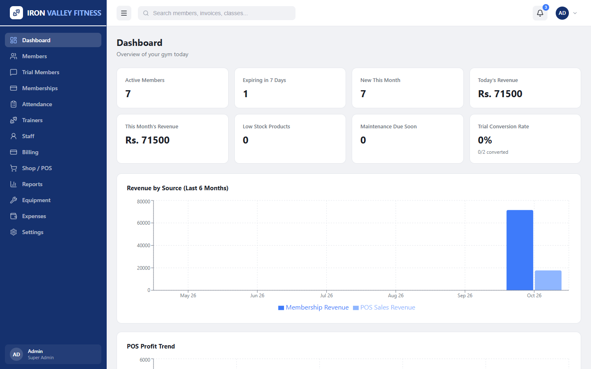
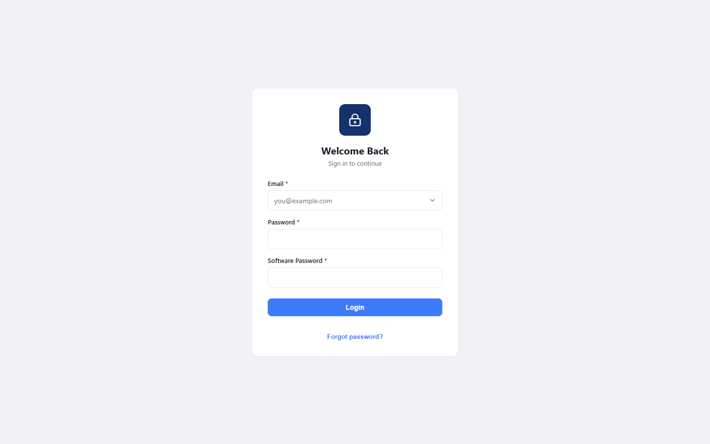
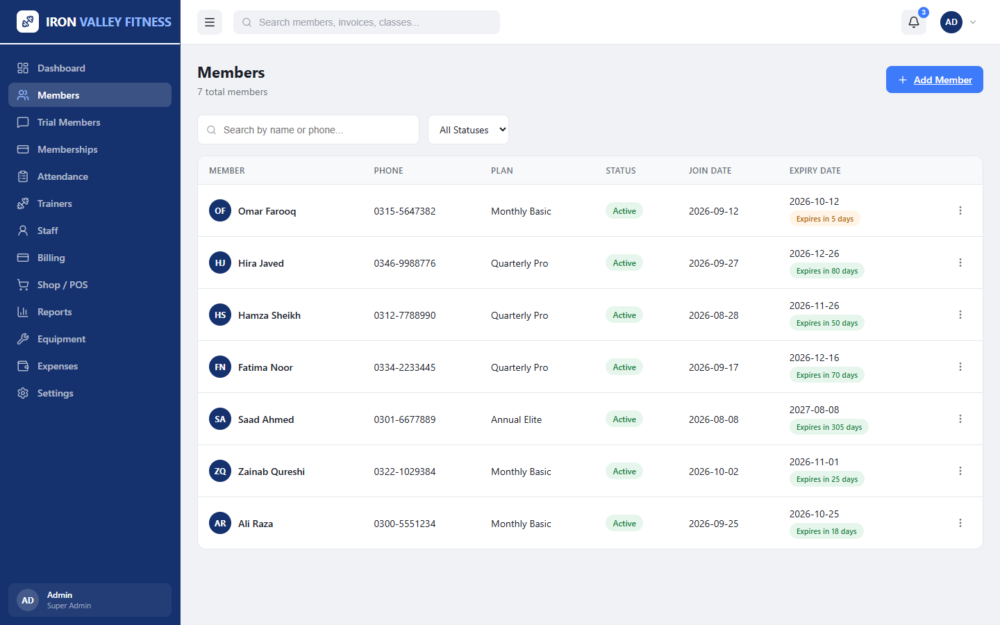
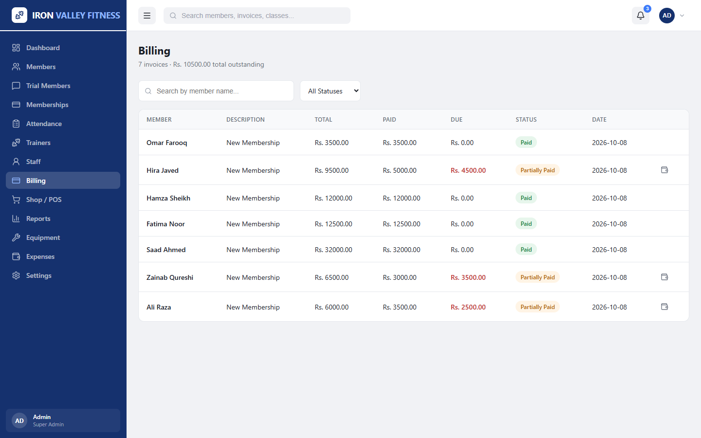
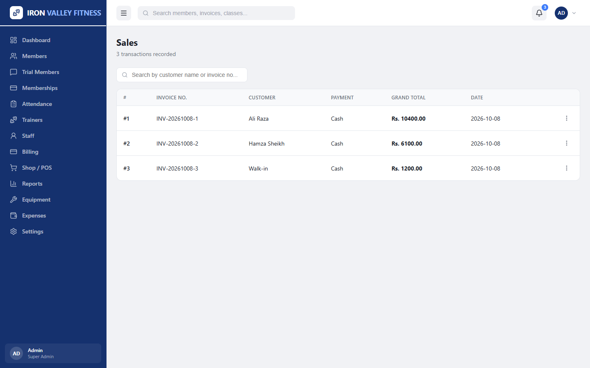
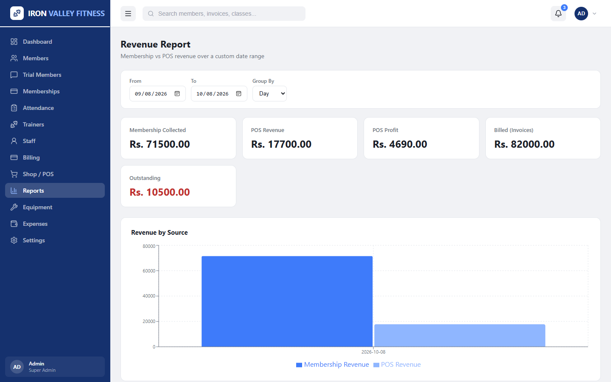
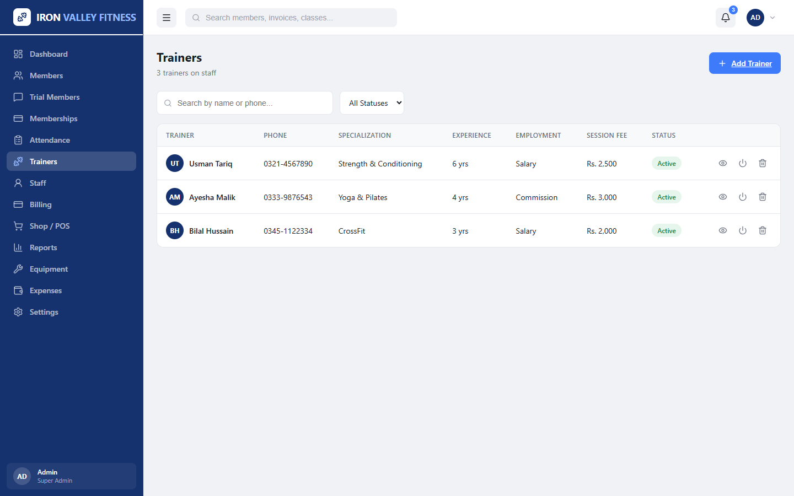

# FitCore Pro

A complete fitness center management platform for running day-to-day gym operations — memberships, billing, trainers, staff payroll, a retail point of sale, equipment upkeep, expenses and business reports — from a single dashboard.



## Features

- **Members** – registration, plan assignment, renewals, upgrades, freeze/resume, membership history and expiry alerts
- **Trial members (leads)** – track walk-in trials and conversion rate
- **Membership plans** – flexible durations and pricing
- **Billing** – invoices with plan/trainer/overall discounts, partial payments and outstanding dues
- **Trainers & staff** – profiles, photos, session fees and monthly salary payments
- **Shop / POS** – product inventory, purchases, low-stock alerts, POS billing with discounts & tax, printable receipts and profit tracking
- **Equipment** – asset register, warranty dates and maintenance schedule
- **Expenses** – categorized operating expenses
- **Reports** – revenue, membership, sales, inventory, payroll, trainers and expenses
- **Security** – admin/user roles, session-based auth, two-step password (account + software password), OTP password reset via email
- **Licensing** – signed, tamper-checked license activation and renewal

## Tech Stack

| Layer    | Technology                                      |
|----------|-------------------------------------------------|
| Frontend | Next.js 16, React 19, Recharts, Lucide icons    |
| Backend  | Node.js, Fastify 5                              |
| Database | MySQL / MariaDB                                 |
| Other    | Nodemailer (SMTP), bcrypt                       |

## Screenshots

| Login | Members |
|-------|---------|
|  |  |

| Billing | Shop Sales |
|---------|------------|
|  |  |

| Revenue Report | Trainers |
|----------------|----------|
|  |  |

> Screenshots use sample demo data.

## Project Structure

```
├── backend/          # Fastify REST API
│   ├── config/       # License configuration
│   ├── routes/       # API route modules
│   └── src/          # App setup, auth & license middleware, mailer
├── database/
│   └── schema.sql    # MySQL schema
├── frontend/         # Next.js app (App Router)
│   └── src/
│       ├── app/      # Pages
│       ├── components/
│       └── lib/      # API client & helpers
└── screenshots/
```

## Getting Started

### Prerequisites
- Node.js 20+
- MySQL 8 or MariaDB 10.4+

### 1. Database
```bash
mysql -u root -p < database/schema.sql
```

### 2. Backend
```bash
cd backend
cp .env.example .env   # then fill in your values
npm install
node index.js          # runs on http://localhost:4000
```

### 3. Frontend
```bash
cd frontend
cp .env.example .env.local
npm install
npm run dev            # runs on http://localhost:3000
```

On first launch the app walks you through license activation, business setup and creating the admin account.

## License

All rights reserved.
